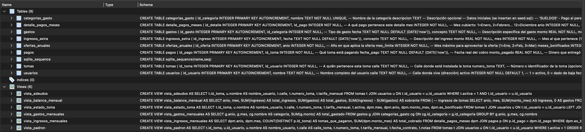
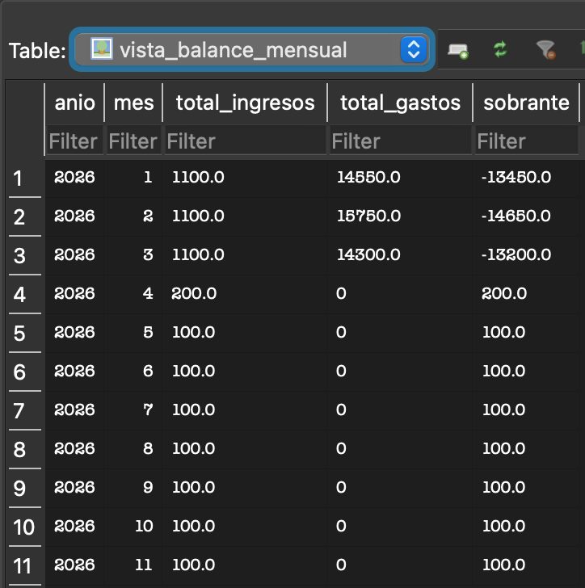
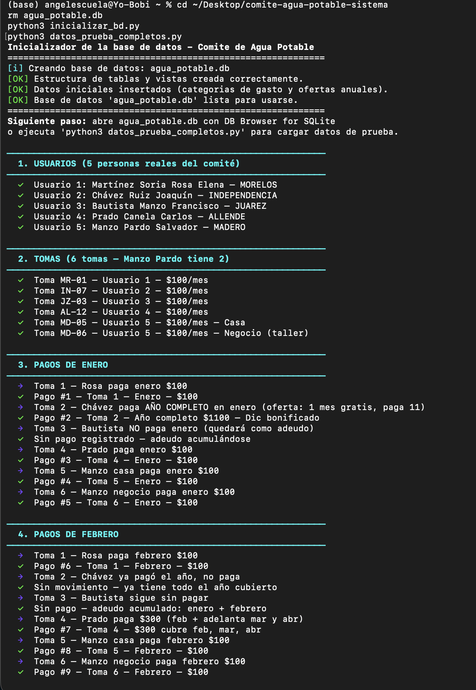

# Sistema de Control y Cobro - Comité de Agua Potable

[](https://www.python.org/)
[](https://www.sqlite.org/)
[](https://opensource.org/licenses/MIT)

Sistema de base de datos local para la digitalización del control de usuarios, tomas, pagos, adeudos y gastos del servicio de agua potable del Comité de Agua Potable de Emiliano Zapata, Villamar, Michoacán.

Reemplaza el registro manual en cuadernos por una base de datos SQLite con vistas de reporte, validaciones y datos de prueba.

---

## Tabla de contenidos

- [Contexto](#contexto)
- [Qué problema resuelve](#qué-problema-resuelve)
- [Capturas](#capturas)
- [Stack tecnológico](#stack-tecnológico)
- [Estructura del proyecto](#estructura-del-proyecto)
- [Instalación y uso](#instalación-y-uso)
- [Reportes disponibles](#reportes-disponibles)
- [Modelo de datos](#modelo-de-datos)
- [Mi rol](#mi-rol)
- [Documentación adicional](#documentación-adicional)
- [Licencia](#licencia)

---

## Contexto

Este proyecto nace durante mi Servicio Social en el H. Ayuntamiento de Villamar, Michoacán, colaborando directamente con el Comité de Agua Potable de la localidad de Emiliano Zapata.

El comité llevaba el control de 300+ usuarios y sus pagos mensuales en cuadernos físicos, lo que dificultaba:

- Consultar el estado de cuenta de un usuario.
- Detectar deudores.
- Calcular ingresos y gastos mensuales.
- Generar reportes para la asamblea.

El proyecto digitalizó el padrón completo, implementó las reglas de negocio del comité (tarifas, ofertas anuales, categorías de gasto) y generó reportes automáticos.

**Periodo:** 26 de enero - 27 de julio de 2026
**Horas cumplidas:** 500
**Usuarios digitalizados:** 300+
**Beneficiarios indirectos:** ~1,200 habitantes

---

## Qué problema resuelve

| Antes (manual) | Después (sistema) |
|---|---|
| Cuaderno por calle | Base de datos SQLite consultable |
| Cálculo manual de adeudos | Vista `vista_adeudos` automática |
| Reportes escritos a mano | Vistas SQL + exportables |
| Búsqueda lenta de un usuario | Consulta por nombre en segundos |
| Sin respaldo | Archivo `.db` portable |

---

## Capturas

### Estructura de la base de datos



### Vista de balance mensual



### Ejecución del inicializador



---

## Stack tecnológico

| Componente | Tecnología |
|---|---|
| Lenguaje | Python 3.10+ |
| Base de datos | SQLite 3 |
| Visualización | DB Browser for SQLite |
| Driver | `sqlite3` (librería estándar) |

Sin dependencias externas más allá de Python estándar.

---

## Estructura del proyecto

```
comite-agua-potable-sistema/
├── inicializar_bd.py           # Crea la BD a partir de schema + seed
├── schema.sql                  # Estructura de tablas y vistas
├── seed.sql                    # Datos iniciales (categorías, ofertas)
├── datos_prueba_completos.py   # Datos ficticios para probar reportes
├── docs/
│   ├── guia-encargada.md
│   └── informe-servicio-social.md
└── capturas/
```

---

## Instalación y uso

### Requisitos

- Python 3.10 o superior
- (Opcional) [DB Browser for SQLite](https://sqlitebrowser.org/dl/)

### Pasos

1. Clonar el repositorio

   ```bash
   git clone https://github.com/AngelCanelaaa/comite-agua-potable-sistema.git
   cd comite-agua-potable-sistema
   ```

2. Crear la base de datos

   ```bash
   python3 inicializar_bd.py
   ```

   Debe mostrar:
   ```
   Estructura de tablas y vistas creada correctamente.
   Datos iniciales insertados.
   Base de datos 'agua_potable.db' lista para usarse.
   ```

3. (Opcional) Cargar datos de prueba

   ```bash
   python3 datos_prueba_completos.py
   ```

   Inserta 5 usuarios ficticios, 6 tomas y pagos de enero a marzo de 2026.

4. Abrir la base de datos

   Abre DB Browser for SQLite, selecciona `Open Database`, elige `agua_potable.db` y ve a la pestaña `Browse Data`.

---

## Reportes disponibles

| Vista | Descripción |
|---|---|
| `vista_padron` | Todas las tomas activas con nombre del usuario |
| `vista_estado_toma` | Meses pagados por cada toma |
| `vista_adeudos` | Tomas con meses sin pagar |
| `vista_ingresos_mensuales` | Ingresos por mes |
| `vista_gastos_mensuales` | Gastos por mes y categoría |
| `vista_balance_mensual` | Balance ingresos vs gastos |

Consulta rápida desde la terminal:

```bash
sqlite3 agua_potable.db "SELECT * FROM vista_balance_mensual;"
```

---

## Modelo de datos

Tablas principales:

- `usuarios` - Personas con contrato
- `tomas` - Contratos individuales (una persona puede tener varias tomas)
- `pagos` - Registro de cada pago recibido
- `detalle_pagos_meses` - Qué meses cubre cada pago
- `gastos` - Gastos del comité
- `categorias_gasto` - Catálogo de categorías
- `ingresos_extra` - Contratos nuevos, donaciones
- `ofertas_anuales` - Descuentos por pago anual anticipado

Reglas de negocio:

- Un usuario puede tener múltiples tomas (casa, negocio).
- Un pago puede cubrir varios meses (adelanto o anual).
- Los meses bonificados por oferta anual se registran con `es_bonificado = 1`.
- Los usuarios y tomas no se borran, se desactivan (`activo = 0`).

---

## Mi rol

Proyecto individual desarrollado durante el Servicio Social.

Responsabilidades:

- Análisis del proceso manual y levantamiento de requerimientos con la encargada del cobro.
- Diseño de la estructura de la base de datos (tablas, relaciones, vistas).
- Desarrollo del script de inicialización y datos de prueba.
- Digitalización del padrón de 300+ usuarios.
- Redacción de la documentación (guías de uso e instalación).
- Capacitación de la encargada del cobro.

---

## Documentación adicional

- [Guía de uso para la encargada](docs/guia-encargada.md) - cómo registrar usuarios, pagos y gastos.
- [Informe de servicio social](docs/informe-servicio-social.md) - informe técnico completo.

---

## Licencia

MIT - ver [LICENSE](LICENSE).

---

**Autor:** Angel de Jesús Canela Figueroa
**Institución:** Instituto Tecnológico de Jiquilpan (TecNM)
**Programa:** Ingeniería en Sistemas Computacionales
